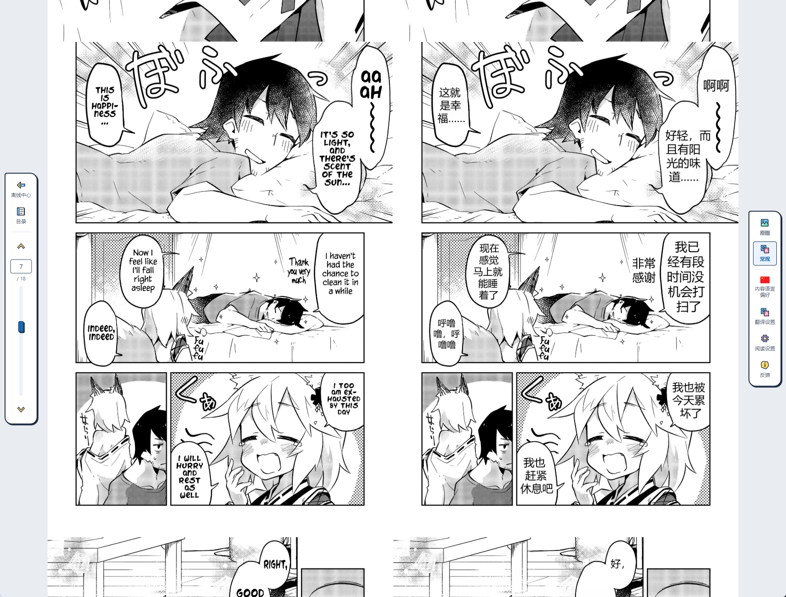

# NodeLane 漫译

[English](README_EN.md) · [下载](https://comics.nodelane.net/) · [反馈](https://github.com/Wy2926/node-comics/issues) · [Telegram](https://t.me/+pPyxB0Sxocw0MDc1)

Chrome、Edge、Firefox 漫画阅读与图片翻译插件。支持本地文件、Google Drive、OPDS 和已适配网站，提供书架、离线缓存与阅读进度恢复。翻译可选官方服务、浏览器本机处理或自建 manga-translator-ui。



## 开发

Node.js 22.12+，在 `apps/extension` 执行：

```sh
npm ci
npm run dev
npm run check
npm test
npm run build
```

构建产物：`apps/extension/.output/chrome-mv3/`。

- [插件开发](apps/extension/README.md) · [网站适配](docs/SITE_ADAPTERS.md) · [翻译约束](docs/TRANSLATION.md)
- [Drive 连接页](apps/drive-connect/README.md) · [辅助脚本](scripts/README.md) · [协作约定](AGENTS.md)
- 后端、官网和管理后台：独立仓库 `node-comics-backend`；计算节点与引擎：`node-comics-compute`。本仓库可独立构建，通过 HTTP 协议连接服务。

[GPL-3.0-only](LICENSE)。第三方代码与字体遵循各自许可；漫画内容版权归原权利人。
