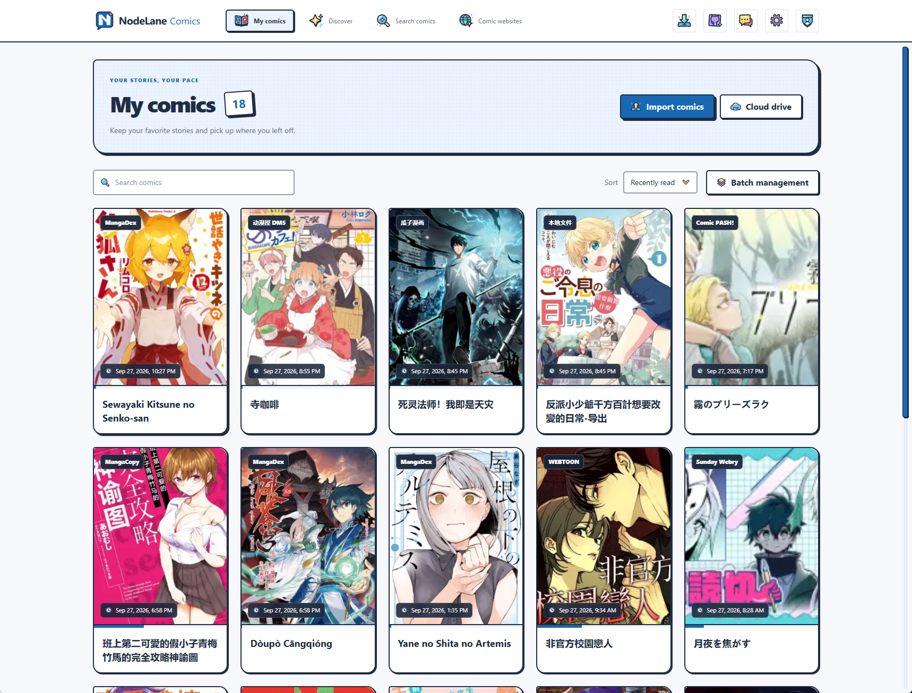
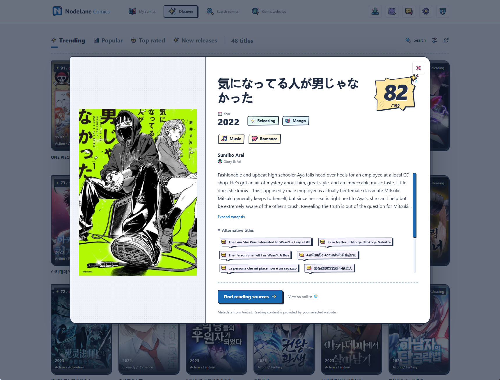
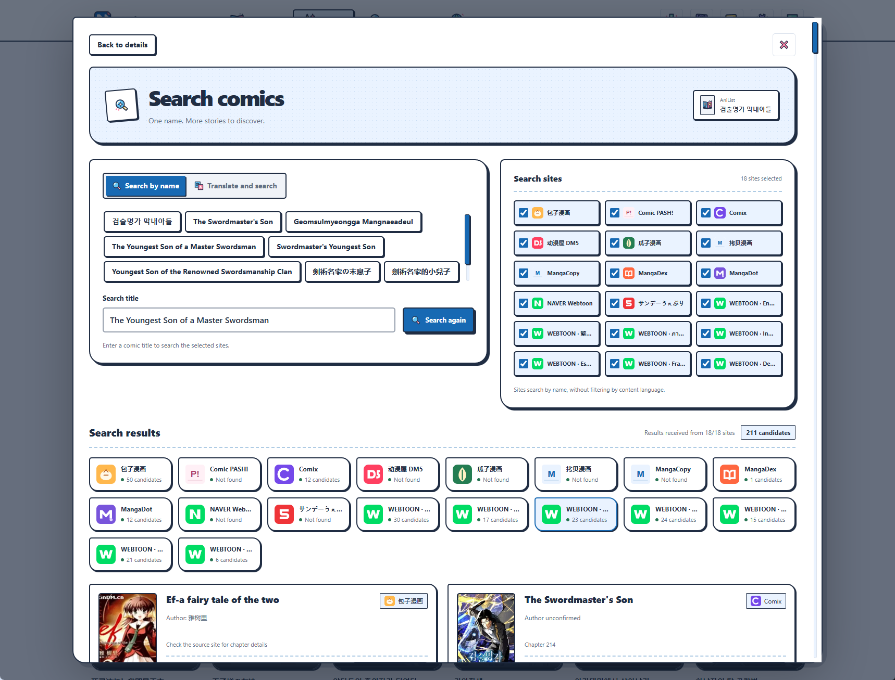
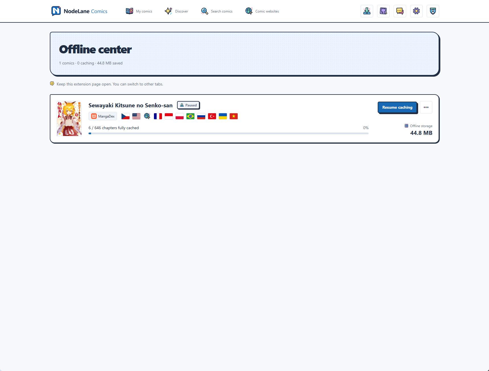
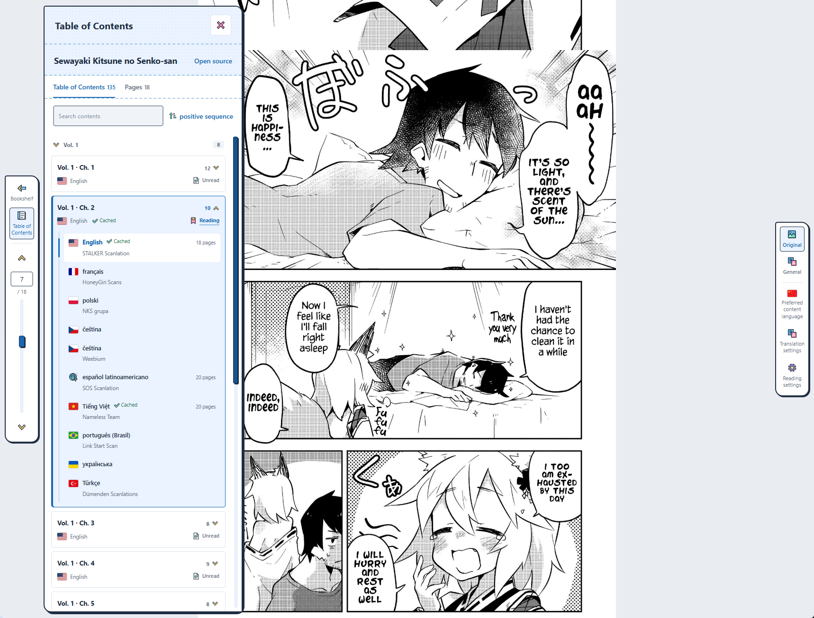
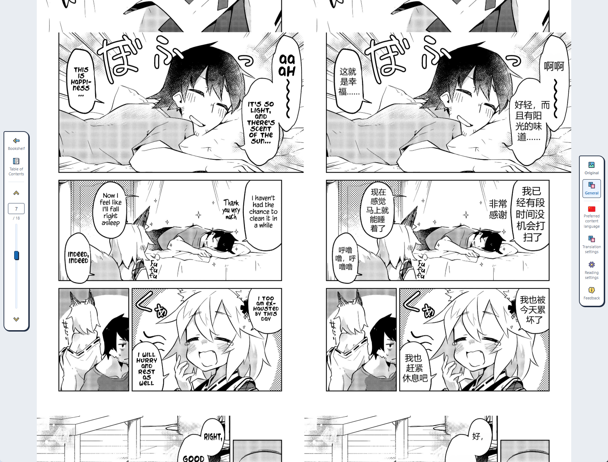

<picture>
  <source media="(prefers-color-scheme: dark)" srcset="apps/extension/src/assets/brand/logo-horizontal-en-dark.webp">
  
</picture>

[简体中文](README.md) | **English**

**Read and translate comics in your browser. Pick up where you left off.**

For Chrome, Edge, and Firefox. Bring comics from local files, Google Drive, and supported websites into your bookshelf, translate as you read, and compare with the original.

Choose browser-local translation (Beta) in Settings and download its models and fonts to get started, without setting up a server. Images stay on your device; recognized text goes to your chosen translation service. You can also use official translation or connect a self-hosted [manga-translator-ui](https://github.com/hgmzhn/manga-translator-ui) service.

## Features

- **Import and read**: Open common comic and ebook files, connect Google Drive or OPDS libraries, or import from supported websites.
- **Find your next read**: Browse charts and search supported sites by title. The website directory includes an adult category and 18+ badges.
- **Read your way**: Scroll or turn single pages or spreads. Choose the direction, zoom, and background, and bookmark your favorite pages.
- **Translate as you read**: Translate images in the reader or on a webpage, compare with originals, and keep your reading position.
- **Continue offline**: Cache supported website comics in advance, pause and resume, or retry missing pages.
- **Make it yours**: Choose from 16 interface languages, six accent colors, light and dark modes, and adjustable text sizes.

### My comics

Import, search, and manage comics, then pick up where you left off.

View discovery, website search, offline caching, chapter navigation, and translation comparison

### Discover comics

Browse charts, read synopses, check ratings and alternative titles, then look for a website where you can read the comic.

### Search comics

Search by title or alternative title, or translate the title first. Choose websites, review the results, and import a comic to start reading.

### Offline center

Manage caching tasks for website comics, track chapter progress and storage use, and pause or resume. Fully cached chapters are available offline.

### Reading and chapter navigation

Browse chapters in the reader, with language options, page counts, cache status, and reading progress.

### Compare originals and translations

Enable translation when you need it. View the original and translated pages side by side, or switch back to the original to keep reading.

These product screenshots were provided by a user. Comic content and cover artwork belong to their respective rights holders.

## Community and feedback

Join the [Telegram community](https://t.me/+pPyxB0Sxocw0MDc1) to discuss the extension and suggest features. To report a problem, open a [GitHub Issue](https://github.com/Wy2926/node-comics/issues) with your browser version, steps to reproduce, and relevant screenshots.

## Development

Module guides and technical documentation

The module guides and technical documents linked below are currently in Chinese.

| Module | Purpose and entry point |
| --- | --- |
| [Browser extension](apps/extension/README.md) | Reader, library, website adapters, and translation UI |
| [Backend](backend/README.md) | API, persistent jobs, accounts, subscriptions, and administration |
| [Website](backend/website/README.md) | Product pages in 17 languages, image translation, guest trials, local history, downloads, and account pages |
| [Drive connection page](apps/drive-connect/README.md) | Google authorization and file selection |
| [Compute node](services/compute-node/README.md) | Install, run, and build the Windows bundle or Linux NVIDIA image |
| [Image engine](services/classic-engine/README.md) | Text detection, OCR, LaMa inpainting, and text rendering |

Each module README lists its requirements and run commands. See the [scripts guide](scripts/README.md) for validation tools.

### Development guidelines

| Topic | Documentation |
| --- | --- |
| Product and reading | [Product design](docs/PRODUCT_DESIGN.md), [Single-source reading](docs/SIMPLE_COMIC_READING_DESIGN.md), [Offline caching](docs/OFFLINE_CACHE_DESIGN.md) |
| Architecture and data | [System architecture](docs/ARCHITECTURE.md), [Sources and caching](docs/COMIC_SOURCE_ARCHITECTURE.md) |
| Translation and compute | [Translation contract](docs/READING_TRANSLATION_CONTRACT.md), [Model selection](docs/TRANSLATION_MODEL_SELECTION_DESIGN.md), [Compute protocol](docs/COMPUTE_PROTOCOL.md), [Cluster scheduling](docs/TRANSLATION_CLUSTER_DESIGN.md) |
| Websites and interface | [Website adapters](docs/SITE_ADAPTERS.md), [Comic discovery](docs/DISCOVERY.md), [Cross-language search](docs/COMIC_SEARCH_DESIGN.md), [Interface localization](docs/UI_INTERNATIONALIZATION.md), [Brand copy](docs/BRAND_AND_STORE_LISTING.md) |
| Accounts and operations | [Membership and quotas](docs/MEMBERSHIP_AND_QUOTAS.md), [Payments](docs/STRIPE_BILLING.md), [Admin console](docs/ADMIN_CONSOLE.md), [Extension analytics](docs/ANALYTICS.md) |
| Deployment and maintenance | [Deployment](docs/DEPLOYMENT.md), [Backup and recovery](docs/OPERATIONS.md), [Code standards](docs/CODE_QUALITY.md), [API contract](contracts/README.md) |

See [AGENTS.md](AGENTS.md) for collaboration guidelines. Product rules are maintained in their topic documents rather than duplicated in this README.

## Licenses

Except for third-party content with explicit separate licensing, the NodeLane Comics project code is licensed under the **GNU General Public License v3.0 only (SPDX: `GPL-3.0-only`)**. See [LICENSE](LICENSE) for the full terms. This software comes without any warranty, as detailed in the license.

Third-party code, models, and fonts remain subject to their accompanying licenses, with their original copyright and license notices retained. See the image engine's [THIRD_PARTY.md](services/classic-engine/THIRD_PARTY.md) for provenance. The software license does not grant rights to comic content, covers, or user data.
