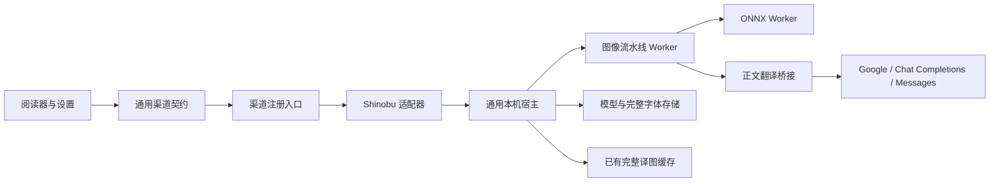

# 浏览器本地翻译渠道

基于 Shinobu 的图像流水线以“浏览器本地翻译”作为独立渠道接入插件：本机执行检测、OCR、去字和嵌字，正文服务可选 Google Translate、OpenAI 兼容 Chat Completions 或 Anthropic Messages。无需 NodeLane 账号，不创建官方任务、不使用官方额度。图片留在本机，仅识别文字发送给所选正文服务。

## 使用与支持范围

在「外观与设置 → 翻译渠道」直接选择内置的「浏览器本地翻译」，无需添加，也不能移除；初始默认渠道仍为 NodeLane。阅读器翻译设置可直接切换渠道，仍与全局设置及网页原位翻译共用当前渠道。

正文服务默认使用谷歌翻译；可添加多个具名 LLM 供应商，每项独立保存地址、模型、访问令牌、思考程度和协议参数。内置 DeepSeek、OpenRouter、OpenAI、Claude、Gemini、GLM / 智谱、Xiaomi MiMo、Kimi 的地址与协议预置，也可添加自定义供应商。全部地址均可改为用户网关；模型名称由用户填写，预置不查询远程模型目录。自定义下拉面板内完成选择、添加、编辑与移除，新增和编辑表单直接显示在面板内。保存供应商后立即使用该项；移除当前供应商回到谷歌翻译。高级协议参数默认收起，本机运行方式和文字过滤单独放在「本机识别设置」，选择后自动保存，不再显示保存按钮。本功能未发布，不迁移或兼容开发期的旧单供应商配置。

首版提供 `classic`，验收范围为日文来源、简体中文和繁体中文目标。其他语言、任意模型导入、任意模型网址、整本后台推理不在本次移植范围。

「管理模型与字体」按文字识别、画面处理、翻译字体分类，以用途名称和说明展示资源，不在主界面暴露模型文件名。显示必需资源就绪数、空间占用和当前所选字体，许可来源收进详情。支持逐项下载、暂停、继续、校验、删除；「下载缺少的必需资源」补齐固定模型包及所选字体，未选择过字体时使用默认字体。模型不自动下载，完整字库不随插件打包。修改字体只影响新任务；已有成功译图保留，手动重译成功后替换。

资源入口复用通用设置行，标题、说明和间距遵循[共享设置层级](POPUP_AND_THEME.md#共享样式的接入方式)。资源弹框使用插件共享的颜色、描边、圆角、硬阴影、文字和间距令牌。桌面高度固定为 760px，受可见窗口高度限制；切换分类不改变弹框尺寸，标题、资源总览、分类与底部说明保留，资源列表独立滚动。矮窗口使用正文滚动以保证全部内容可访问，关闭按钮保持可见。

「本地翻译字体」使用独立于远程渠道的字体下拉界面，按目标语言展示本机支持的完整字库。按钮和列表显示下载状态，列表内可直接下载、继续或重试；校验完成后才可选用。关闭下拉不停止下载，进度与资源管理界面同步。字体选择器只读取固定字体目录的元数据，不扫描模型或字体文件，关闭时不轮询；普通渠道继续使用原字体选择器。

LLM 服务地址填写版本前缀，例如 `http://127.0.0.1:1234/v1`，不包含 `/chat/completions`、`/responses` 或 `/messages`。允许 HTTP/HTTPS 服务，包括本机与局域网 IP、域名；是否可达由实际请求决定，不通过浏览器联网状态提前拒绝 LLM 请求。供应商数量不设插件上限。本地正文服务允许用户配置自己的 API Key 或网关访问令牌，仅存入扩展的凭据库；本机无鉴权模型服务可留空。费用由用户所选服务计收。NodeLane 官方服务的密钥与执行边界不变。

## 模型基线与来源

上游源码已拉取为与本仓库平级的独立 checkout；插件采用提交 [`c4239a2c653c68f66283b990f96936234c8d7294`](https://github.com/DonutShinobu/ShinobuTranslator/tree/c4239a2c653c68f66283b990f96936234c8d7294) 的固定源码快照。构建不依赖平级目录。上游版本 0.8.7，实际运行依赖 ONNX Runtime Web 1.27.0、Comlink 4.4.2，均锁定版本。

模型来自上游 `models-v0.8.3` Release，固定名称、大小与 SHA-256，详情保存在 [manifest.json](../apps/extension/third_party/shinobu/packages/model-manifest/manifest.json)。完整下载之后校验存储字节，校验通过才可用于推理。

| 资源 | 字节数 | 上游许可记录 |
| --- | ---: | --- |
| 文本检测 detector.ort | 94,863,096 | GPL-3.0 |
| OCR PP-OCRv6_medium_rec.onnx | 76,554,979 | Apache-2.0 |
| OCR 字典 paddleocr_v6_dict.txt | 74,947 | Apache-2.0 |
| 去字 aot_inpaint_512.onnx | 22,749,561 | GPL-3.0 |
| 气泡 bubble.onnx | 11,626,988 | Apache-2.0 / AGPL-3.0，保留上游原有标注 |
| 合计 | **205,869,571（196.33 MiB）** | 不含字体 |

上游原有许可、第三方声明与 [publication-policy.json](../apps/extension/third_party/shinobu/packages/model-manifest/publication-policy.json)作为来源记录保留。插件不据此设置安装或运行门禁，也没有开发构建专用解锁开关。正常使用 `npm run build`，在 Chrome 扩展管理页加载 `.output/chrome-mv3`。

## 解耦边界

| 入口 | 职责 |
| --- | --- |
| [definition.ts](../apps/extension/src/translation/channels/adapters/shinobu/definition.ts) | 内置渠道、字段、字体偏好、资源管理、结果读取及来源删除钩子 |
| [runtime.ts](../apps/extension/src/translation/channels/adapters/shinobu/runtime.ts) | 有限阅读窗口、准入、恢复、状态投影、手动重试；不复用 HTTP 直传运行器 |
| [operations.ts](../apps/extension/src/translation/channels/adapters/shinobu/operations.ts) | 操作、输入与正文检查点；按页查询、按 entry 索引分批删除 |
| [host.ts](../apps/extension/src/translation/channels/adapters/shinobu/host.ts) / [engine.ts](../apps/extension/src/translation/channels/adapters/shinobu/engine.ts) | 单任务执行、模型资源租约、Worker 生命周期及输出缓存 |
| [pipeline.worker.ts](../apps/extension/src/translation/channels/adapters/shinobu/pipeline.worker.ts) | 上游平台适配，注入正文服务和所选完整字体 |
| [services.ts](../apps/extension/src/translation/channels/adapters/shinobu/services.ts) | 多供应商配置、凭据绑定、选择及稳定结果作用域 |
| [providers.ts](../apps/extension/src/translation/channels/adapters/shinobu/providers.ts) | 供应商预置、模型思考能力与参数映射；纯配置逻辑，不访问网络 |
| [text/](../apps/extension/src/translation/channels/adapters/shinobu/text) | Google、Chat Completions 与 Messages 协议，输出校验和请求回执；不依赖 Canvas 或视觉模型 |
| [storage/local-assets/](../apps/extension/src/storage/local-assets) | 1 MiB 分块、Range 续传、流式摘要校验、状态与删除互斥 |
| [ChannelOptions.tsx](../apps/extension/src/ui/ChannelOptions.tsx) | 按通用字段与资源契约显示表单；不导入具体适配器 |
| [host-background.ts](../apps/extension/src/translation/channels/host-background.ts) / [local-translation-host/](../apps/extension/entrypoints/local-translation-host) | 管理隐藏宿主的创建与回收，通过渠道注册入口按需加载本机执行器 |
| [third_party/shinobu/](../apps/extension/third_party/shinobu) | 固定源码、许可、来源摘要和可复现补丁 |

`registry.ts` 是唯一具体适配器装配点。来源、书架、官方 API、额度和翻译调度核心不增加 Shinobu 分支。公共契约只增加可选的字段/资源管理和本机宿主能力，现有渠道仍按原接口运行；目标语言继续沿用现有设置规则。

## 资源与执行生命周期

Chrome 隐藏文档仅使用 `runtime` 扩展 API，通过消息请求后台管理生命周期；模型、字体、图片和结果仍使用同源 IndexedDB 与 Blob。入口不承担阅读器、官方服务或额度逻辑。

- 资源按 SHA-256 存入独立 IndexedDB，1 MiB 分块与已提交偏移在同一事务写入。每次完成网络读取后才读取下一块，资源下载全局串行。
- 续传发送 Range 与可用的强 ETag。206 必须匹配起点、终点和总大小，200 会从头覆盖；错误范围或超长内容不能成为已安装资源。中断仅保留已提交分块。
- 下载不按空间估算提前拒绝，实际写入遇到浏览器配额不足时提示并保留已提交进度；校验时逐块计算 SHA-256。空闲 30 秒的网络读取会中止；错误和暂停状态可见。重新校验失败会撤销就绪状态，允许重新下载。
- 跨页面 Web Locks 保证下载、删除和推理互斥。推理持有模型与字体的共享租约，使用中删除明确失败。资源的删除不移除已有译图。
- 一个宿主同时执行一张图，最多接收现有阅读窗口的 7 个候选。Worker 内执行计算，运行时仅从已验证 Blob URL 读取模型；映射缺失立即失败，不隐式联网补模型。
- 同字体、运行方式的会话可复用，空闲 60 秒释放会话、Worker、FontFace 和 Blob URL，并关闭空闲宿主。Chrome/Edge 使用 `offscreen` 隐藏文档，不打开标签页或窗口；创建与关闭串行处理，关闭前重新确认当前宿主正在释放，旧文档的迟到关闭消息不能打断新宿主任务。关闭阅读器不会打断已经接受的单页工作；「模型与字体」中的「停止本地任务」可中止当前工作和下载队列。未提供 offscreen 的浏览器复用既有后台页面的 DOM 环境，空闲时释放执行器。
- 本地适配器不设图片边长或像素数量上限；在解码前核实图片元信息，沿用上游处理流程，真实解码或推理失败在当前页显示。

执行代码、Worker、ORT 的 MJS/WASM 随插件发布，模型和完整字体手动下载。不得把远程 JS/WASM 当作模型资源加载。WXT 使用显式 `?worker` 导入，避免构建保留不存在的 TypeScript Worker 地址。

## 正文协议与恢复

Google 使用 POST 正文，逐区域保持边界，禁止携带 Cookie、Referer 和自动重定向。不会把 OCR 文本放进 URL。Google 的公开网页接口不具备服务 SLA，限流/失败在当前页显示，由用户重试。访问限制或跳转验证页明确显示 Google 不可用，不提示检查 LLM 令牌，也不自动重发。

Chat Completions 使用 `model`、`messages`、`stream:false`。输出 Token 留空时不发送上限字段；填写时仅检查正整数，按所选的 `max_tokens` 或 `max_completion_tokens` 发送，不设插件统一范围。Messages 使用独立 `system`、`messages`、`max_tokens` 和 `x-api-key` 鉴权；该接口要求输出上限，预置为 16384，用户可修改。两个协议都默认省略 Temperature，开启思考时不发送该参数；Kimi 不显示该项。

思考默认关闭，按供应商发送实际关闭参数；服务自身默认开启时也不能只省略字段。根据模型能力显示可用程度：只有开关的模型显示「开启」，支持强度的显示对应档位。已知强制思考的模型提示用户主动选择程度或换模型，保存时校验，不擅自开启。模型别名或自定义网关以其实际协议为准；自定义 Chat Completions 可选择 `reasoning_effort`、OpenRouter `reasoning`、`thinking.type`、`enable_thinking` 或不发送思考参数。最后一项仅用于不需要思考控制的模型。

| 预置 | 思考参数与官方依据 |
| --- | --- |
| DeepSeek | `thinking.type` 开关，开启后发送 `reasoning_effort`；[思考模式](https://api-docs.deepseek.com/guides/thinking_mode/) |
| OpenRouter | 关闭为 `reasoning.enabled:false`，开启后使用 `effort`；不把仅隐藏输出的 `exclude` 当作关闭；[Reasoning tokens](https://openrouter.ai/docs/guides/best-practices/reasoning-tokens) |
| OpenAI | 按模型使用 `reasoning_effort`，非思考模型省略；[Reasoning](https://developers.openai.com/api/docs/guides/reasoning?api-mode=chat) |
| Claude | 原生 Messages；旧款使用 1024 / 4096 / 8192 的思考预算，输出上限必须大于预算；支持自适应思考的型号使用 `thinking` 与 `output_config.effort`；[Extended thinking](https://platform.claude.com/docs/en/build-with-claude/extended-thinking) |
| Gemini | OpenAI 兼容接口的 `reasoning_effort`；[OpenAI compatibility](https://ai.google.dev/gemini-api/docs/openai) |
| GLM / 智谱 | `thinking.type`，支持程度的型号额外使用 `reasoning_effort`；[深度思考](https://docs.bigmodel.cn/cn/guide/capabilities/thinking) |
| Xiaomi MiMo | `thinking.type` 开关，输出上限默认使用 `max_completion_tokens`，兼容 Bearer 鉴权；[Chat Completions](https://mimo.mi.com/docs/api/text-generation/openai-api) |
| Kimi | 可切换型号使用 `thinking.type`；K3 系列使用 `reasoning_effort`；[思考模型](https://platform.kimi.com/docs/guide/use-thinking-models) |

基础模式依靠提示词返回 JSON，不发送结构化输出字段；明确选择后，Chat Completions 使用 `json_object` 或 `json_schema`，Messages 使用 `output_config.format` 的 JSON Schema。思考与结构化输出设置同时保留。不会在参数拒绝后自动换参数、换协议或重发请求。

响应必须正常结束，拒绝截断、拒绝响应、工具调用、无内容信封。正文必须为区域 ID 到字符串的 JSON 对象（允许单个 JSON 代码围栏）；区域集合精确匹配，拒绝重复、未知、缺失 ID 和空译文。不会用额外模型调用修复响应。

正文不分批，不设区域数、文本字符数或固定总耗时限制。LLM 每页一次请求，Google 仍逐区域串行请求以保持文本边界；等待至服务返回、网络失败或用户主动停止。响应读取保留 1 MiB 上限。两者只接收 ID 和文字，不接收图片、裁图、坐标、源站地址或阅读历史。

操作键固定为作用域、目标语言与页面意图。每个尝试另有 UUID，冻结配置摘要包括引擎/文本协议版本、源图 SHA、字体 SHA、正文参数。Google 与各 LLM 供应商使用独立、稳定的结果作用域，切回原供应商可以恢复其已缓存译图。更换某供应商的端点、接口协议或令牌仅改变该项结果作用域；更换字体/OCR/模型或思考参数保留旧成功图，手动重译使用新摘要。活跃任务使用开始时固定的服务参数与令牌，不再依赖整个渠道配置修订；后续编辑影响新任务，修改其他供应商不打断当前任务。令牌经受信任的扩展消息传给宿主并仅留在运行内存；持久令牌只存于凭据库，不放入供应商列表、操作记录、检查点或普通设置。

正文请求前先保存整页输入及 `sending` 状态，写入失败就不发送；整页成功校验后保存结果。完整正文结果仅在源图、配置、稳定区域 ID、OCR 和顺序完全匹配时复用。检查点上限 64 MiB，保留 24 小时后在宿主启动时分批回收。

上游正文阶段自动重试已关闭。断开、超时或回执不确定时不会自动再次请求或改用 Google；宿主丢失后恢复为中断，由用户手动新建尝试。手动重试可沿用匹配的整页成功正文结果；请求未完成时重试整页。Google 的部分区域成功不作为整页完成回执。

运行器通过现有渠道等待入口读取状态，不另设后台轮询；只在状态变化时发布结果，恢复不创建任务、不重复刷新阅读器。通用阅读窗口同时监听已交付译图的绑定变化，保证同作用域的异步绑定恢复能重新注册显示引用，不重启阅读节奏或新建翻译。迟到的旧尝试不能覆盖新尝试或已完成结果；移除漫画先写 tombstone，阻止输入、检查点和译图晚到回写。完整译图走已有缓存 generation 与页面绑定。无文字页只保存 `no_text`，不另存原图副本；检测异常不降级成“无文字”。

## 字体与第三方来源

复用插件已有的 5 个中文字体 ID 和预览选择器，实际嵌字下载对应完整 TTF/OTF。现有预览 WOFF2 只有样例字符，不能用于漫画正文。默认诺托黑体完整文件为 16,437,364 字节；全部字体描述见 [font-resources.json](../apps/extension/src/translation/font-resources.json)。

字体偏好按本地渠道和目标语言保存，切换正文供应商不会重置字体。全局设置与阅读器内的字体选择直接用于本机嵌字，并明确提示先下载完整字库、已有译图需手动重译。固定字体 SHA、版本与字重，并从同一字库生成 Unicode 覆盖表；测量、换行与绘制使用同一已加载 FontFace。排版前按 Unicode 码点跳过所选字库不支持的字符，保留其他字符与空白，不回退系统字体；整段过滤后为空时不绘制，也不回填原文。覆盖表仅在宿主启动推理时读取，不放进阅读器/后台的初始化数据。

源码和依赖的许可证随构建保留；字体许可沿用 `public/fonts/translation/`。复现说明与实际运行依赖版本见 [INTEGRATION.md](../apps/extension/third_party/shinobu/INTEGRATION.md)。不记录原文、译文、网关令牌、源站 URL 或调试图。

## 验证与实际限制

本机验证环境为 macOS、Chrome 156.0.8078.48、Apple M6 / 24 GiB，使用单独的 Shinobu Debug 浏览器配置与自制 900×1200 双页 CBZ。

- Chrome 已验证：5 个模型和默认字体安装与摘要校验，检测模型在 53 MiB 暂停后继续，切换 Google/LLM 动态字段、真实 Google 正文调用、完整图像流水线、诺托黑体和霞鹜文楷嵌字、原图/译图切换以及重开后缓存与阅读位置恢复。
- Chrome 已验证供应商预置、自定义地址、动态思考字段、新增与编辑后的刷新恢复、无效配置提示、移除当前项回到 Google、供应商与渠道来回切换、第二页位置保持和字体偏好保持。相同图片共用结果时，切换前先按渠道和图片摘要查询已交付绑定，避免异步恢复期间重复翻译。
- 隐藏宿主已在 Chrome 验证实际模型出图、资源下载、关闭阅读器后完成已接受任务、重开后的结果恢复及空闲自动关闭，全程不打开宿主标签页。生命周期测试覆盖并发创建、忙碌时保活、空闲释放和旧文档关闭消息隔离。
- 基础 Chat Completions 已通过浏览器调用本机与局域网 HTTP 协议夹具验证，LLM 每页一次请求，输出 Token 留空时不携带上限字段。含缺字译文成功出图，仅跳过缺字字符；刷新后缓存与第二页位置恢复，没有重复请求。夹具返回的文字完成嵌字；它不是实际 LLM 模型效果验证。
- OpenRouter 已使用生产请求与解析代码、两句自拟日文调用 `openai/gpt-5.4-mini`，关闭思考与低强度两次均返回有效译文；服务回报思考 Token 分别为 0 与 12。没有发送用户漫画或保存测试密钥。其余供应商和原生 Messages 通过协议夹具与官方参数核对，尚未进行各家的真实服务验收；真实 JSON Schema 服务与复杂漫画 LLM 效果仍未验收。
- 单元测试覆盖分块续传/错误范围/空间不足、校验失败、资源租约、协议与输出校验、整页正文复用、未知结果不重发、晚到写入、删除隔离和恢复状态去重；另运行插件完整测试、类型/模块/i18n 检查和构建。
- 同一工具链构建的 HEAD 基线磁盘总大小 23,876,459 字节；接入构建约 53 MB，主要增量为 26,827,543 字节的 ORT WASM。模型权重及新增完整字体没有打包。WXT 汇总会重复计数公共资产，此处按实际文件计量。
- 未验证的项目包括跨平台/Firefox/Safari、密集竖排与长条真实漫画效果、长时稳定性及未启用新渠道时的延迟对照。不能据两页合成样本承诺通用漫画效果。

通用渠道约定以[客户端翻译渠道](TRANSLATION_CHANNELS.md)为准，官方执行、权益及额度规则仍由[翻译契约](READING_TRANSLATION_CONTRACT.md)维护。
